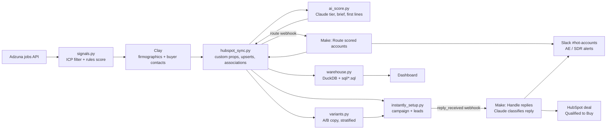

# GTM Engine: from hiring signal to booked meeting

An outbound system I built and ran end to end in one weekend. It finds companies whose job postings show warehouse labor pain, scores them with rules and then with Claude, writes everything into HubSpot, routes the best accounts to the right rep in Slack, runs the email sequence in Instantly, and turns a positive reply into a HubSpot deal with no human in the loop. A DuckDB + SQL layer reports on every stage.

**Seller is fictional, prospects are real.** The product is *Brava Robotics*, a made-up humanoid Robot-as-a-Service company for warehouse tote handling. The accounts, job postings and firmographics are real public data. Every email went to inboxes I own; no prospect was contacted.

Full write-up with the reasoning behind each step: [GTM Engine on Notion](https://app.notion.com/p/418d7363678781bcb303c01e5bc53987)

## Results from the live run

| Stage | Count |
|---|---|
| Companies with warehouse hiring signals (Adzuna, last 30 days) | 787 |
| After ICP filter (no staffing agencies, consultancies, robot makers) | 440 |
| Top accounts enriched (Clay) and pushed to HubSpot | 50 companies, 58 contacts |
| Scored Tier A or B by Claude | 34 |
| Tier A routed to a rep in Slack | 11 (10 to AE, 1 to SDR) |
| Test sequence: sent, reply, classified "interested", deal created | 3, 1, 1, 1 ($60,000 at Qualified to Buy) |

Rules and AI disagreed in useful ways. The rules ranked Abercrombie & Fitch #2 on hiring volume, and Claude dropped it to Tier C because the postings were retail store staff, not warehouse roles. Home Depot Canada and EMCO were demoted the same way, and Conagra was promoted. That's `sql/04_rules_vs_ai.sql`.

## How it works



| Step | File | What it does |
|---|---|---|
| 1. Signals | `signals.py` | Turns raw job postings into ranked accounts. Score = labor pain (warehouse postings), footprint (sites hiring), automation readiness (controls/automation roles), plus a bonus when both show up. Staffing firms and non-buyers are filtered out by regex. |
| 2. Enrichment | Clay (MCP) | Firmographics for the top 50 and 1–3 buyer contacts each (VP Ops, Director of Warehouse Ops, site leads). |
| 3. CRM | `hubspot_sync.py schema / accounts / enrich` | Creates the `gtm_*` property group, then batch-upserts companies and contacts on unique keys so reruns never duplicate, and associates contacts to companies. Assigns persona (economic buyer / champion / operator) and segment (enterprise / mid-market / SMB). |
| 4. AI scoring | `ai_score.py`, `hubspot_sync.py ai` | Claude reads each account's signals and firmographics and returns fit score, tier, reasoning, a 3-bullet brief and a first line per contact, as JSON. Retries with backoff, resumable, every call logged. |
| 5. Routing | `hubspot_sync.py route`, `make/` | Posts each scored account to a Make webhook. The router sends Tier A enterprise to the AE and Tier A mid-market to the SDR, each with a Slack alert carrying the brief. Tier B goes to nurture and C/DQ gets parked. Every step has an error route to `#gtm-engine-alerts`. |
| 6. Sequencing | `instantly_setup.py` | Builds the Instantly campaign (2 steps), loads leads with AI first lines, registers the reply webhook, launches. |
| 7. Reply → pipeline | `make/` (Handle replies) | On reply, Claude classifies it (interested / objection / not now / wrong person / unsubscribe / OOO). The contact gets tagged; if interested, a deal is created and associated to the company, and Slack gets pinged with a summary and next step. |
| 8. Copy testing | `variants.py`, `hubspot_sync.py variants` | Two step-1 angles: A opens on the hiring signal, B on the cost of unfilled shifts. Accounts are alternated A/B within each segment × tier bucket, so both arms get the same mix (31 vs 30 contacts, 42% vs 37% Tier A), and `hubspot_sync.py variants` writes it to each HubSpot contact so replies and deals trace back to the copy. Status: collecting. The 3 test sends predate the variants, and a reply-rate difference needs ~200 sends per arm. |
| 9. Analytics | `warehouse.py`, `sql/` | Loads every artifact into DuckDB and runs 8 queries: funnel, tier by segment, signal drivers, rules vs AI, AI ops (latency, tokens, failure rate), data-quality checks, rep worklist, copy A/B test. |

## Run it

```bash
pip install -r requirements.txt
cp .env.example .env          # add your own keys

python signals.py                         # data/adzuna_raw_companies.json -> data/accounts_ranked.json
python hubspot_sync.py schema             # one-time: custom properties
python hubspot_sync.py accounts           # upsert top 50 companies
python hubspot_sync.py enrich             # upsert Clay firmographics + contacts
python ai_score.py                        # Claude scoring -> data/ai_scored.json
python hubspot_sync.py ai && python hubspot_sync.py segment
python variants.py && python hubspot_sync.py variants   # stratified A/B copy assignment
python make/build_blueprints.py           # import both JSONs into Make, fill placeholders
python hubspot_sync.py route              # fire every account through the router
python instantly_setup.py campaign && python instantly_setup.py leads \
  && python instantly_setup.py webhook && python instantly_setup.py launch
python hubspot_sync.py snapshot && python warehouse.py   # -> data/metrics.json
```

`python warehouse.py` runs straight away on the committed data, with no keys needed.

## Things that broke and what I changed

- **Claude response parsing.** The first content block isn't always text, so I join every `type == "text"` block. 33 of the first 83 calls failed because responses were truncated at 900 tokens; I raised the limit and made the script resume only unscored accounts. The failure rate is kept in `sql/05_ai_ops.sql` rather than hidden.
- **Free text inside JSON bodies.** Reply text and AI reasoning contain quotes and newlines that break hand-built JSON in Make, so they pass through `json:TransformToJSON` (or are escaped before posting) first.
- **Blank emails in Instantly.** Plain-text bodies with `<br>` arrived empty, and editing the campaign afterwards didn't fix what got sent. Bodies are now wrapped in `<div>` per line from creation; the blank emails stayed in the test results.
- **Routing errors shouldn't stop the batch.** Each HTTP step has an error handler that posts the account and error to Slack, then skips that record.

## Data and privacy

- `data/` has the real company-level outputs: job-posting signals, rankings, AI scores and run logs.
- Contact names are replaced with stable pseudonyms (`Contact 001`), emails are placeholders, and per-contact AI first lines are removed. Raw Clay and HubSpot exports are not in the repo.
- No credentials are committed. Everything reads from environment variables, and the Make blueprints use `{{PLACEHOLDER}}` values.

Stack: Python, DuckDB, SQL, HubSpot CRM API, Clay, Claude API (Haiku), Make, Slack webhooks, Instantly API v2, Adzuna API.

Built by Awais.
